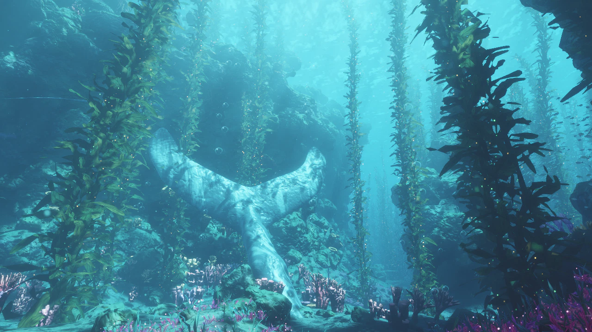
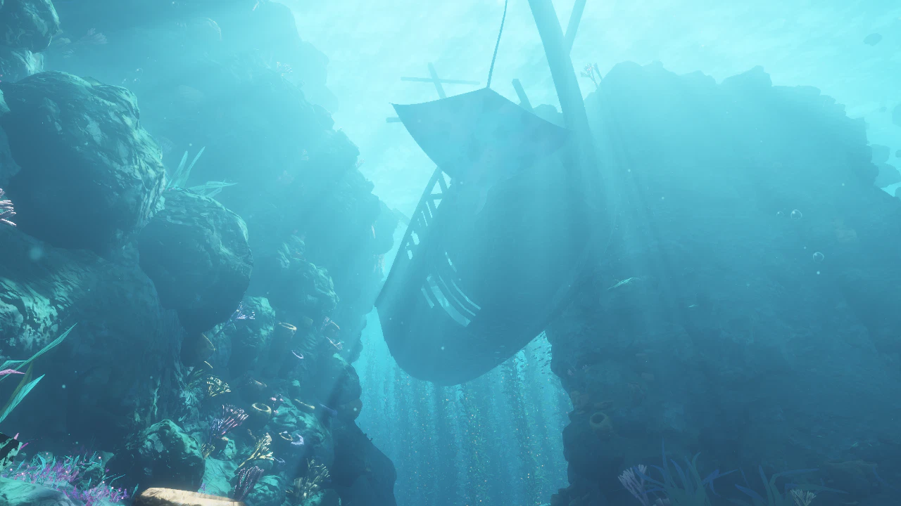
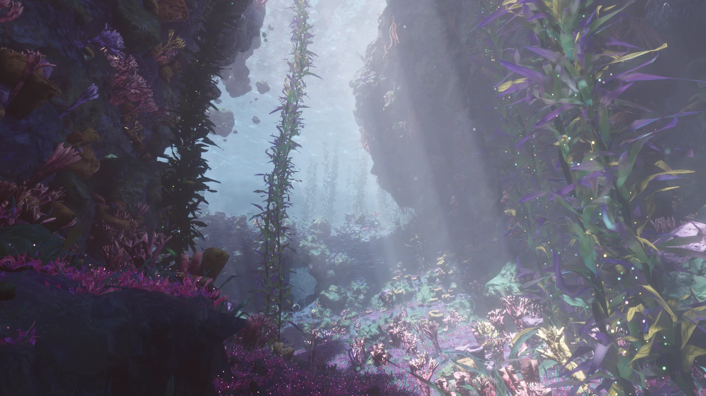

# Abyssal Garden · Godot

[Читать на русском](README_RUS.md)

A Godot .NET and C# port of Abyssal Garden, a procedural underwater world with kelp forests, a wreck, manta rays, and volumetric sunlight. The port is based on Maksymilian Dendura’s original WebGPU demo. [Upstream repository](https://github.com/Noniv/abyssal-garden) · [Browser demo](https://noniv.github.io/abyssal-garden/)



<p>
  <a href="docs/screenshots/shipwreck.webp"></a>
  <a href="docs/screenshots/grotto.webp"></a>
</p>

## Run the Godot project

```powershell
git clone https://github.com/warlock-su/abyssal-garden-godot.git
cd abyssal-garden-godot
```

Open `project.godot` in Godot **4.8 beta 3 .NET** with the **.NET 10 SDK** and press **F5**. The tested desktop configuration is Windows with Forward+ and Vulkan. [Godot downloads](https://godotengine.org/download/archive/4.8-beta3/)

The game generates the selected world profile on startup. The checkout and Windows build contain the compiled shader library and need no pre-generated world data or Node.js to run.

The main and pause menus offer Russian and English, window presets, and three detail levels. The rendered image follows the window’s client area pixel for pixel. To test window presets from the editor, run the game in a separate window. [Godot game embedding](https://docs.godotengine.org/en/stable/tutorials/editor/game_embedding.html)

| Input | Action |
| --- | --- |
| Mouse, WASD | Look and swim |
| E / Q, Shift | Rise, sink, and swim faster |
| 1–6 | Jump to a viewpoint |
| Esc, M, H | Pause, mute, and show detailed statistics |
| F, B | Guided route and 60-second benchmark |

For a Windows x64 build, install the matching **.NET export templates** and use the **Windows Desktop** preset. Run `build/windows/AbyssalGarden.exe` with its PCK and .NET data directory beside it.

## Rendering and benchmarks

Godot’s `RenderingDevice` builds a seabed density field on the GPU. A C# worker generates the terrain mesh, collision bricks, vegetation, landmarks, wildlife, and skylight for the selected profile. The game then draws instanced geometry with spatial culling and LOD. Separate GPU passes handle shadows, animated water and caustics, light shafts, and bloom. The original WGSL is compiled to SPIR-V.

The initial port used the browser generator's exported world data. The table records its **mean / p99** times in milliseconds for the same 60-second route on an RTX 5090 at High. Chrome 157 ran WebGPU and Godot 4.8 beta 3 ran Vulkan. At 2560×1440 Godot rendered a full-size buffer and presented it in a 1280×720 window.

| Render resolution | Chrome frame | Godot frame | Chrome GPU | Godot GPU |
| --- | ---: | ---: | ---: | ---: |
| 1280×720 | 1.60 / 2.00 | 1.56 / 1.85 | 1.58 / 1.90 | 1.54 / 1.82 |
| 2560×1440 | 2.52 / 3.10 | 2.34 / 2.78 | 2.50 / 2.97 | 2.32 / 2.75 |

SSIM across six fixed views at 1280×720 High was **0.991–0.997** with the exported browser world and **0.643–0.803** with runtime generation. GPU floating-point differences affect the generated terrain and the seeded placement of vegetation and small objects.

In a subsequent Windows Release comparison on the same GPU at High and 1280×720, the generated world measured **1.64 / 1.96 ms** per frame. The build with exported world data measured **1.63 / 1.86 ms** in the adjacent run. Runtime world generation took **1.7–2.1 s** on High and the export PCK fell from **240 MiB to 1.0 MiB**.

```powershell
New-Item -ItemType Directory -Force .godot/abyssal-comparison
godot-mono --path . --resolution 1280x720 --disable-vsync --audio-driver Dummy -- --quality=0 --benchmark
godot-mono --path . --resolution 1280x720 --disable-vsync --audio-driver Dummy -- --quality=0 --render-size=2560x1440 --benchmark
godot-mono --path . --resolution 1280x720 -- --quality=0 '--capture=.godot/abyssal-comparison/godot-0-{view}.png'
```

Replace `godot-mono` with your Godot .NET executable. `--render-size` sets an explicit render buffer size for comparison. `{view}` saves all six camera views at animation time zero. Run the Godot and Chrome benchmarks separately.

To capture the browser reference and reproduce the image and performance comparisons, run the following commands after generating the Godot captures.

```powershell
npm install --prefix .godot/port-tools --no-audit --no-fund playwright-core pngjs@7.0.0
$chromePath = 'C:/Program Files/Google/Chrome/Application/chrome.exe'
node tools/measure-reference.mjs . .godot/port-tools/node_modules $chromePath 1280x720 0 capture
node tools/compare-frames.mjs .godot/port-tools/node_modules .godot/abyssal-comparison/reference-0-1.png .godot/abyssal-comparison/godot-0-1.png
node tools/measure-reference.mjs . .godot/port-tools/node_modules $chromePath 1280x720 0 benchmark
```

## Rebuilding the shaders

Use Node.js 24 to regenerate the shader library after changing the upstream WGSL. The fork includes the original shader sources in `source/`. [Original revision](https://github.com/Noniv/abyssal-garden/tree/a596354eff400d458bc2aeb9bdf5e0a9734b2bcf)

```powershell
npm install --prefix .godot/port-tools --no-audit --no-fund naga-wasi-cli@0.1.0
node tools/compile-shaders.mjs
```

## Credits and license

Original world, generator, and shaders by Maksymilian Dendura (Noniv). Godot port by Warlock Su. This fork preserves the original MIT copyright and permission notice in [LICENSE](LICENSE). The shader library carries the same notice in [assets/abyssal/LICENSE.txt](assets/abyssal/LICENSE.txt). [Original project](https://github.com/Noniv/abyssal-garden)
